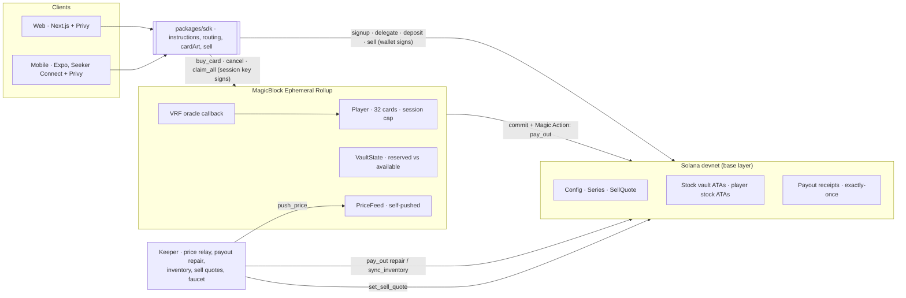

# Architecture

## Layers and who signs what

| Action | Layer | Signer |
|---|---|---|
| `signup`, `delegate_*`, `deposit_usdc`, `sell_to_vault` | Solana | wallet (Privy embedded or Seeker/MWA), sign-only, we send |
| `create_session` | rollup | wallet |
| `buy_card`, `cancel_pending`, `claim_all`, `mark_settled` | rollup | session key (local ed25519, no popups) |
| `push_price`, `sync_inventory` | rollup | keeper |
| `pay_out` (Magic Action) | Solana | delegation program escrow; keeper `pay_out` is the repair path |

## Card lifecycle

`Empty → Paid → RandomnessPending → Revealed → ClaimRequested → Settled`, plus `RandomnessPending → Cancelled` on VRF timeout.

- `buy_card` reserves the worst-case liability (`max_multiplier × ticket ÷ price`) and requests one scoped VRF per card.
- The callback is bound to the request id (sha256 of player, card id, caller seed, index), is idempotent, and releases the unused reservation.
- `claim_all` (≤ 8 cards of one series) commits the Player and schedules one `pay_out_action` per winning card. The `Payout` PDA makes each payout exactly-once; the keeper repairs dropped actions.

## Pricing

- **Path B (default, equities):** keeper relays Pyth Hermes into a program-owned `PriceFeed` on the rollup; `push_price` is pusher-gated, banded and monotonic. Trust assumption: the keeper is the price relay.
- **Path A (MagicBlock oracle):** decodes the live `PriceUpdateV3` account (owner `PriCems…`), exponent from the series, max-move band stored on `VaultState`. Used when MagicBlock publishes the feed.
- Both: staleness pauses sales; the buyer passes `max_price`.

## Selling

Stock lives on Solana, so `sell_to_vault` is one atomic base-layer instruction against a keeper-posted `SellQuote` (90 s TTL, 50 bps spread, slippage guard), paid from a USDC pool owned by the Config PDA. Mainnet would use the MagicBlock Payments API swap (implemented in the SDK, refused on devnet).

## Known limits (devnet)

See `docs/PROGRESS.md` → Verification gaps, and `docs/DECISIONS.md` for every deviation from the build prompt.
